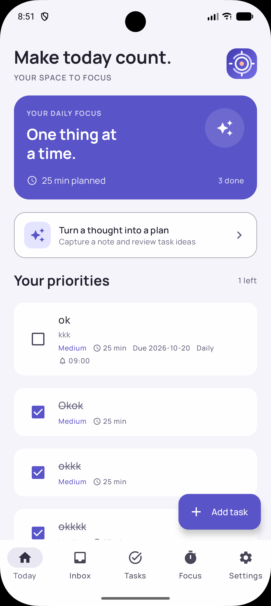
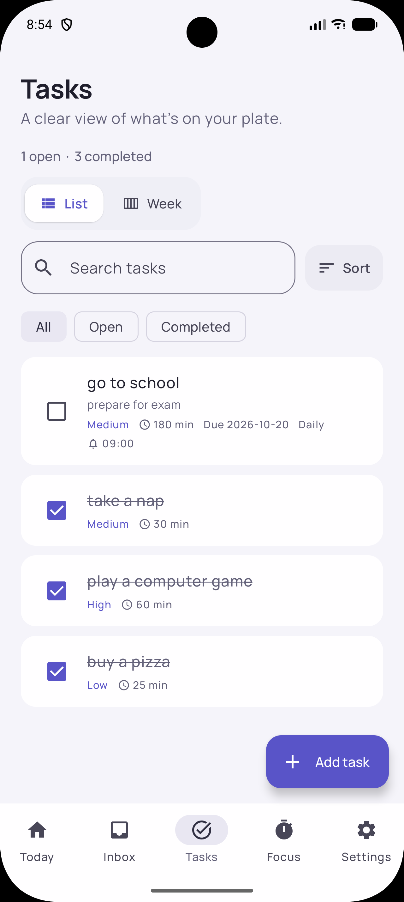
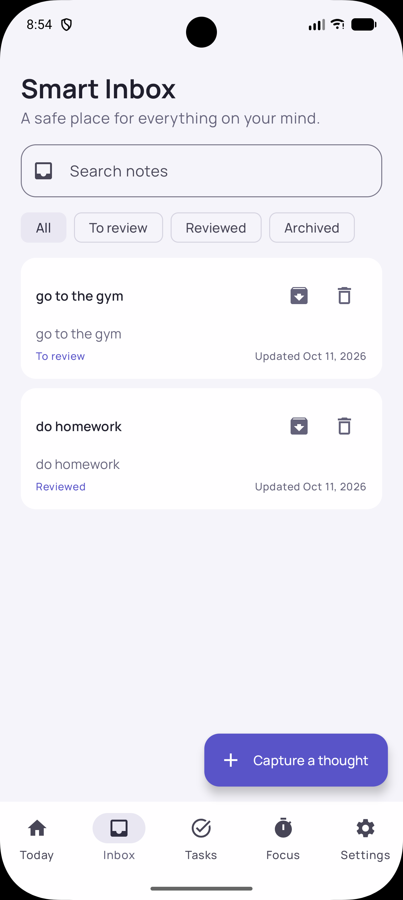
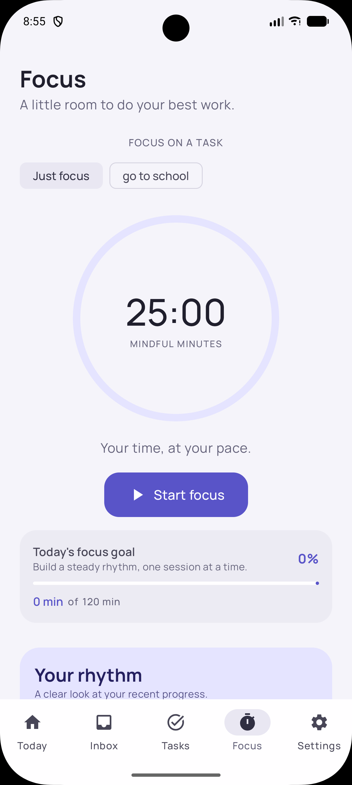
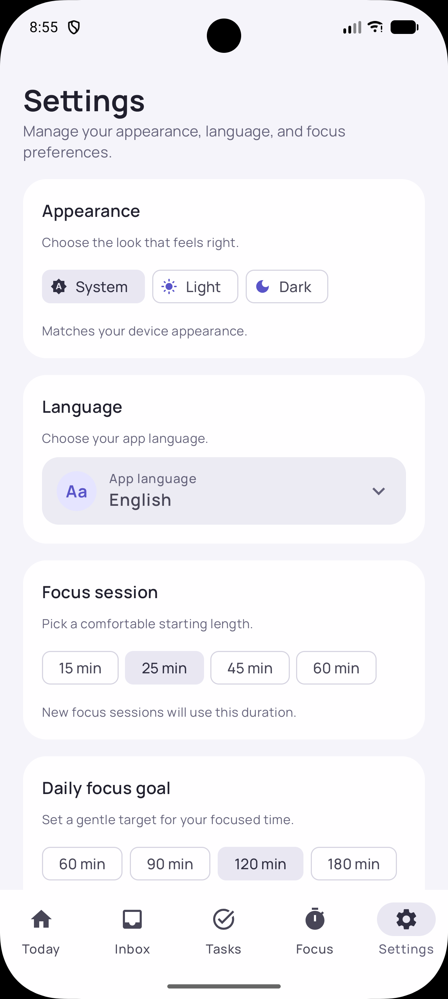

# FocusAI

**A calmer way to turn the things on your mind into focused, manageable work.**


[](https://github.com/hosseinkarami-dev/focus-ai/actions/workflows/ci.yml)

FocusAI is a privacy-minded productivity app for Android and iOS. Capture a thought in your Inbox, shape it into a task when you are ready, and make room for focused work with a built-in timer. Tasks, notes, preferences, and focus history are stored locally on your device.

> **AI status:** sample suggestions are the default. A separately deployable OpenAI-backed Ktor service is included; the app contacts it only when a backend URL is configured and the user requests suggestions. In remote mode, note text is sent to the configured FocusAI service and OpenAI. The OpenAI key stays on the server. The service is not deployed and needs authorization, gateway abuse controls, and a published privacy/retention policy before public use.

## What you can do

- **Capture without losing momentum:** save and edit notes in a searchable Inbox; review, archive, restore, or delete them.
- **Plan your work:** create and edit tasks with due dates, reminders, priorities, time estimates, repeat rules, and checklists.
- **See your workload your way:** search and filter tasks, sort by your order, due date, priority, or title, and switch between a task list and a date-based week view.
- **Keep plans close:** use home-screen widgets and launcher shortcuts to view tasks, add a task, or capture a thought.
- **Focus in sessions:** link a task to a timer, pause or resume a session, review your history and insights, and set a daily focus goal. Optional break reminders are available.
- **Make it yours:** choose Light, Dark, or System appearance and use the app in English, Persian, Spanish, French, or Arabic. Persian and Arabic use right-to-left layout.
- **Stay in control:** task suggestions remain a preview until you choose what to keep. Local task and note workflows do not require an account or network connection.

## Screenshots and entry points

| Today | Tasks | Inbox |
| --- | --- | --- |
|  |  |  |

| Focus | Settings |
| --- | --- |
|  |  |

Android provides a home-screen widget and launcher shortcuts. iOS provides a WidgetKit widget and launcher quick actions. Their task and capture links open the corresponding app flows.

## Built with

- Kotlin Multiplatform and Compose Multiplatform with Material 3
- MVVM presentation state shared across Android and iOS
- Koin dependency injection
- Room with bundled SQLite for local persistence
- Ktor and kotlinx.serialization for the provider/network boundary
- Native Android notifications and iOS UserNotifications for local reminders
- WidgetKit on iOS and an Android home-screen widget

The shared module targets Android, iOS arm64, and iOS simulator arm64. Platform-specific widget, notification, launcher, and app-entry code lives alongside the shared UI and data layers.

## Build

### Android

```sh
./gradlew :androidApp:assembleDebug
```

### iOS

Open [`iosApp/iosApp.xcodeproj`](iosApp/iosApp.xcodeproj) in Xcode and build the `iosApp` scheme. The iOS widget extension is included in the app target. App Group capabilities must be registered for the signing team before installing the app and refreshing the widget on a device.

### AI backend (optional)

The default build uses sample suggestions and makes no AI network request. To use real suggestions, deploy the service in `aiBackend/` behind HTTPS, then configure the app with the full endpoint URL, for example `-PfocusAiBackendUrl=https://your-api.example/v1/ai/extract-tasks` for Android or set `FOCUSAI_BACKEND_URL` to that full endpoint in `iosApp/Configuration/Config.xcconfig`. Set `OPENAI_API_KEY`, `OPENAI_MODEL`, and optionally `PORT` in the backend environment. Never put the OpenAI key in the app.

Run the service locally with `OPENAI_API_KEY=... OPENAI_MODEL=... ./gradlew -p aiBackend run`. It exposes `GET /health` and `POST /v1/ai/extract-tasks`. Build a container from the repository root with `docker build -t focusai-backend .`; provide `OPENAI_API_KEY` and `OPENAI_MODEL` at runtime. The included in-memory per-IP limit is intended for a single small deployment; the service has no client authentication, so put it behind an authenticated gateway with rate limits and abuse controls before public use. Review OpenAI data handling and configure retention to match your product policy before enabling a production endpoint.

## Continuous integration

GitHub Actions runs shared Android host tests, builds the Android app, compiles and runs Room migration instrumentation tests on an Android emulator, tests the AI backend, compiles the shared iOS arm64 framework, and builds the iOS app for a generic device with code signing disabled. CI does not launch an iOS simulator. The current workflow is green; see the [CI runs](https://github.com/hosseinkarami-dev/focus-ai/actions/workflows/ci.yml) for the latest result.

## Project structure

```text
androidApp/   Android app entry point, notifications, launcher actions, and widget
iosApp/       SwiftUI app entry point, WidgetKit extension, and iOS project
shared/       Compose UI, MVVM state, Room data, localization, and shared platform APIs
aiBackend/    Optional Ktor service that calls OpenAI without exposing its key to clients
docs/         Product, design, architecture, testing, and roadmap documentation
```

## Project documentation

- [Product specification](docs/product/product-specification.md)
- [Design system](docs/design/design-system.md)
- [Screen specifications](docs/design/screen-specifications.md)
- [Architecture](docs/architecture/architecture.md)
- [AI contracts](docs/architecture/ai-contracts.md)
- [Implementation roadmap](docs/roadmap/implementation-roadmap.md)
- [Testing strategy](docs/testing/testing-strategy.md)

## Current status

The core local-first flows are implemented, including task and note management, focus sessions, reminders, recurring tasks, daily focus goals, localization, Android and iOS home-screen entry points, and settings. Android and backend checks pass in CI; the unsigned generic iOS device build also passes. Store distribution still requires app signing and physical-device verification. The optional AI service is not deployed; deploy it only after configuring authentication, gateway-level abuse controls, HTTPS, and a published data-retention policy. See the [implementation roadmap](docs/roadmap/implementation-roadmap.md) for the remaining release work.
