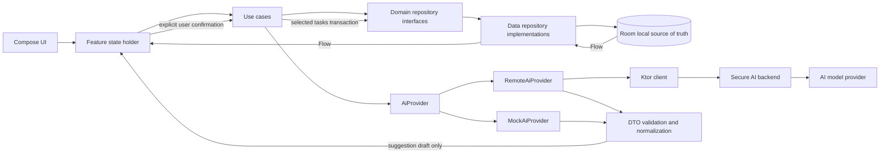

# Architecture

## Repository baseline

The repository began as an early Kotlin Multiplatform starter. The current implementation has a Compose Material 3 Today shell, five tab destinations, shared MVVM state, Room 3 task, note, preference, and focus session persistence, Koin wiring, Ktor with kotlinx.serialization JSON, a typed HTTPS `RemoteAiProvider` adapter, and a clearly labeled deterministic sample provider selected at runtime. The FocusAI focus mark appears in shared Compose UI and native app icons; the app uses an indigo/lilac palette with an apricot accent. Android/iOS use native entry points, with database file creation platform-specific. Inbox notes can be captured, searched, filtered by review/archive state, reopened, edited, archived/restored, deleted with confirmation, and sent through an in-app sample suggestion/review flow. Dates follow the selected language and each platform’s local timezone. Tasks support local create/edit/delete, completion with Undo, text search, All/Open/Completed filters, persisted manual order, optional ISO due dates, and editable checklist steps. Settings persist System/Light/Dark appearance, English/Persian/Spanish language and a 15/25/45/60-minute focus default; Persian switches the shared layout to RTL. Focus sessions use saved timestamps for start, pause, resume, finish and discard, may link to a task, restore after app recreation, and appear in recent history. Room schema v8 adds language preference; earlier schema versions add focus sessions, notes, task order, due dates, subtasks, archive state and other preferences, with automatic migrations through v8. Task completion feedback uses a branded toast with Undo. No note is sent to a backend because the sample provider remains active. Derived insights, note delete undo, and secured AI backend integration remain future work. Existing starter tests have not been run for this change.

## Proposed shared package layout

Keep the existing application module while adding feature-oriented packages inside `shared/src/commonMain/kotlin/io/github/hosseinkarami_dev/focusai`:

```text
app/                 App root, startup, navigation destinations
core/model/          Shared value types, Result/error types, clock abstraction
core/database/       Room database, entities, DAO, entity/domain mappers
core/network/        Ktor client setup, typed transport/error mapping
core/preferences/    Theme and small local preferences
feature/today/       Today UI, state holder, events
feature/inbox/       Capture/list/editor and analysis review
feature/tasks/       Task list/details/planner/breakdown
feature/focus/       Timer/history
feature/insights/    Derived metrics
feature/settings/    Settings/privacy UI
domain/model/        Task, Note, FocusSession and domain enums
domain/repository/   TaskRepository, NoteRepository, FocusRepository, SettingsRepository
domain/usecase/      User-intent operations
data/repository/     Repository implementations and mappers
data/ai/             AiProvider, DTOs, mock and remote adapters, validation
di/                  Koin modules by platform and layer
ui/theme/            Tokens, Material 3 schemes, typography
```

Feature packages can be split into Gradle modules only after build times or ownership make the boundary useful. Avoid an interface per class.

## Domain and boundaries

Domain models are platform-neutral and contain stable IDs, user-authored fields, timestamps, and explicit nullable metadata. `Task`: id, title, description?, priority, status, deadline `LocalDate`?, estimateMinutes?, planDate?, planOrder?, subtasks, createdAt, updatedAt, completedAt?, archivedAt?, provenance. `Note`: id, body, createdAt, updatedAt, archivedAt?, analysis state. `FocusSession`: id, taskId?, plannedDurationSeconds?, startedAt, accumulatedRunningSeconds, lastResumedAt?, endedAt?, outcome. Keep persistence entities and wire DTOs separate.

Repositories are the only domain-facing persistence boundary: note/task/session/settings streams are Flow; mutations are suspend functions. Use cases own user-intent validation and orchestration, e.g. `SaveNote`, `AnalyzeNote`, `ConfirmTaskSuggestions`, `CompleteTask`, `UpdatePlanOrder`, `StartFocusSession`, `PauseFocusSession`, `FinishFocusSession`, `ObserveInsights`. Composables render state and emit events. A feature state holder/ViewModel collects Flow and invokes use cases; it does not implement business rules or make direct network/database calls.

## Data flow

Local CRUD: UI event → state holder → use case → repository → Room transaction → Flow emission → UI state. AI: user taps Analyze → save/preserve note → use case calls provider → parse/validate/normalize DTO into suggestion draft → render editable suggestion state → explicit confirm → use case writes selected normalized domain tasks in one local transaction. The provider has no repository reference and cannot write to Room. Failure leaves note and local state intact.



## Local-first and timer behavior

Room is source of truth for notes, tasks, subtasks and sessions. UI observes Flow; network is used only for explicit AI operations. Save drafts locally before analysis. The timer persists each lifecycle transition: start timestamp, pause accumulated duration, resume timestamp, finish timestamp and outcome. On display/reopen derive elapsed time from accumulated duration plus the difference between current wall time and last resume; clamp negative intervals. The UI refreshes its display once per second, while Room timestamps remain authoritative through backgrounding and process recreation. Injected clock support and lifecycle/device verification remain follow-up work.

## State, navigation, errors

Feature state is immutable and scoped to feature destinations; events express intent (`Save`, `Analyze`, `Retry`, `ConfirmSelected`, `Dismiss`). Preserve form state through temporary navigation and persist meaningful drafts. Model expected failures as typed outcomes (offline, timeout, unauthorized/configuration, rate limited, invalid response, storage failure, validation); map to short user messages at presentation edge and retain diagnostic cause without note contents or credentials. Cancellation is distinct from failure. Never log raw note text, authorization headers, or provider payloads.

Use Compose Multiplatform navigation after validating a library compatible with current KMP/Compose setup, or a small route abstraction until that decision is tested; do not select a dependency by popularity alone. Primary tabs retain independent back stacks/scroll state. Android system back and iOS navigation/sheet semantics must be verified on device.

## Dependencies and compatibility plan

Current catalog versions: Kotlin 2.4.20, AGP 9.1.1, Compose Multiplatform 1.12.1, Material 3 1.12.0-alpha03, Android compile/target 37, min 24. These are what files declare as of repository inspection, not independently validated compatibility claims.

Dependencies added for the representative implementation:

- Room 3 KMP runtime/compiler plus bundled SQLite driver, with KSP and schema export. Android and iOS paths are separate platform implementations.
- Ktor Client core, Android and Darwin engines, content negotiation and kotlinx.serialization JSON integration. A typed HTTPS adapter exists, but no backend endpoint is configured and runtime DI selects the sample provider.
- kotlinx.serialization compiler plugin/JSON runtime and Koin core/Compose/ViewModel packages.
- Coroutines and Flow are used for state and Room observation; direct declarations remain subject to Gradle dependency resolution through existing shared APIs.
- Navigation: absent; compare official/available Compose Multiplatform options against tab state, back stack, and iOS behavior before selecting.

Versions are pinned in the catalog. Android assembly and iOS compilation must be checked against the current project toolchain; any incompatibilities need a deliberate version adjustment rather than silent dependency substitution.

## Dependency injection and platform responsibilities

Koin modules: `commonModule` for use cases and abstractions; `dataModule` for repositories, provider choice and shared clients; `platformModule` for database driver, secure platform settings/clock and any engine. Composition root starts DI once per app lifecycle. `MockAiProvider` is selected in previews/tests and can be a local development configuration. Production `RemoteAiProvider` calls only a configured backend base URL; credentials stay on the server. Android owns Activity and Android database driver/engine as needed. iOS owns SwiftUI/UIViewController lifecycle and Apple database driver/engine as needed. Shared app behavior stays in common code.

## Testing strategy summary

Test use cases and DTO validation with fake repositories/provider and injected clock; Room mappings/transactions against platform test databases; feature state holders with deterministic Flow/provider outcomes; Ktor adapter against a local test engine; Android/iOS startup, back, safe areas, font scaling, accessibility, and lifecycle timer restoration on simulators/devices. Detailed layers and acceptance checks live in `../testing/testing-strategy.md`.
