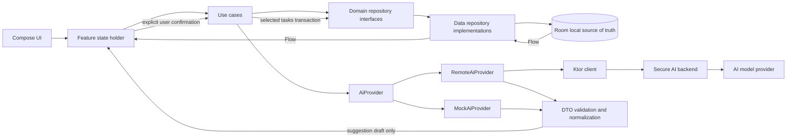

# Architecture

## Repository baseline

The repository is an early Kotlin Multiplatform starter. `shared` targets Android, iOS arm64, and iOS simulator arm64, and already includes Compose Multiplatform, Compose Material 3, Compose UI/runtime/foundation, and lifecycle Compose artifacts. `App.kt` is the generated click-and-greeting sample; there is no app navigation, persistence, domain/data layer, DI, Ktor, Room, Koin, or product feature yet. Android uses a Compose Activity and iOS hosts the shared Compose view through SwiftUI. Existing tests exercise starter greeting behavior only. No `AGENTS.md` or existing product documentation was found. Repository metadata is absent (`.git` was not present in the inspected directory), so a Git change summary is unavailable.

## Proposed shared package layout

Keep the existing application module while adding feature-oriented packages inside `shared/src/commonMain/kotlin/io/github/hosseinkarami_dev/focusai`:

```text
app/                 App root, startup, navigation destinations
core/model/          Shared value types, Result/error types, clock abstraction
core/database/       Room database, entities, DAO, entity/domain mappers
core/network/        Ktor client setup, typed transport/error mapping
core/preferences/    Theme and small local preferences
feature/today/       Today UI, state holder, events
feature/inbox/       Capture/list/editor and analysis review
feature/tasks/       Task list/details/planner/breakdown
feature/focus/       Timer/history
feature/insights/    Derived metrics
feature/settings/    Settings/privacy UI
domain/model/        Task, Note, FocusSession and domain enums
domain/repository/   TaskRepository, NoteRepository, FocusRepository, SettingsRepository
domain/usecase/      User-intent operations
data/repository/     Repository implementations and mappers
data/ai/             AiProvider, DTOs, mock and remote adapters, validation
di/                  Koin modules by platform and layer
ui/theme/            Tokens, Material 3 schemes, typography
```

Feature packages can be split into Gradle modules only after build times or ownership make the boundary useful. Avoid an interface per class.

## Domain and boundaries

Domain models are platform-neutral and contain stable IDs, user-authored fields, timestamps, and explicit nullable metadata. `Task`: id, title, description?, priority, status, deadline `LocalDate`?, estimateMinutes?, planDate?, planOrder?, subtasks, createdAt, updatedAt, completedAt?, archivedAt?, provenance. `Note`: id, body, createdAt, updatedAt, archivedAt?, analysis state. `FocusSession`: id, taskId?, plannedDurationSeconds?, startedAt, accumulatedRunningSeconds, lastResumedAt?, endedAt?, outcome. Keep persistence entities and wire DTOs separate.

Repositories are the only domain-facing persistence boundary: note/task/session/settings streams are Flow; mutations are suspend functions. Use cases own user-intent validation and orchestration, e.g. `SaveNote`, `AnalyzeNote`, `ConfirmTaskSuggestions`, `CompleteTask`, `UpdatePlanOrder`, `StartFocusSession`, `PauseFocusSession`, `FinishFocusSession`, `ObserveInsights`. Composables render state and emit events. A feature state holder/ViewModel collects Flow and invokes use cases; it does not implement business rules or make direct network/database calls.

## Data flow

Local CRUD: UI event → state holder → use case → repository → Room transaction → Flow emission → UI state. AI: user taps Analyze → save/preserve note → use case calls provider → parse/validate/normalize DTO into suggestion draft → render editable suggestion state → explicit confirm → use case writes selected normalized domain tasks in one local transaction. The provider has no repository reference and cannot write to Room. Failure leaves note and local state intact.



## Local-first and timer behavior

Room is source of truth for notes, tasks, subtasks and sessions. UI observes Flow; network is used only for explicit AI operations. Save drafts locally before analysis. The timer persists each lifecycle transition: start timestamp, pause accumulated duration, resume timestamp, finish timestamp and outcome. On display/reopen derive current elapsed time from accumulated duration plus the difference between a trusted current clock and last resume; clamp invalid negative values and account for process death. Use injected `Clock` for deterministic tests; prefer platform monotonic time for an active process and persisted wall-clock checkpoints for restoration. Do not use a UI coroutine as the authoritative timer.

## State, navigation, errors

Feature state is immutable and scoped to feature destinations; events express intent (`Save`, `Analyze`, `Retry`, `ConfirmSelected`, `Dismiss`). Preserve form state through temporary navigation and persist meaningful drafts. Model expected failures as typed outcomes (offline, timeout, unauthorized/configuration, rate limited, invalid response, storage failure, validation); map to short user messages at presentation edge and retain diagnostic cause without note contents or credentials. Cancellation is distinct from failure. Never log raw note text, authorization headers, or provider payloads.

Use Compose Multiplatform navigation after validating a library compatible with current KMP/Compose setup, or a small route abstraction until that decision is tested; do not select a dependency by popularity alone. Primary tabs retain independent back stacks/scroll state. Android system back and iOS navigation/sheet semantics must be verified on device.

## Dependencies and compatibility plan

Current catalog versions: Kotlin 2.4.20, AGP 9.1.1, Compose Multiplatform 1.12.1, Material 3 1.12.0-alpha03, Android compile/target 37, min 24. These are what files declare as of repository inspection, not independently validated compatibility claims.

Requested libraries are not present:

- Room Multiplatform: needed for relational local persistence and observable queries. Before adding, verify current Room KMP plugin/runtime/compiler support for Kotlin 2.4.20, AGP 9.1.1, iOS targets, and the project's Gradle setup.
- Ktor Client: needed for backend transport on Android and iOS. Verify engine selection and versions; keep engine wiring platform-specific if required.
- kotlinx.serialization: needed for versioned typed AI payloads. Check whether the serialization compiler plugin must be applied and ensure it matches Kotlin.
- Koin: needed to swap mock/remote providers and construct shared app graph. Verify KMP APIs/version and avoid platform-specific app startup leakage.
- Coroutines/Flow: Flow is part of the expected shared reactive model; add explicit aligned dependency if not transitively/explicitly available.
- Navigation: absent; compare official/available Compose Multiplatform options against tab state, back stack, and iOS behavior before selecting.

No dependencies are added in this design phase. Pin compatible versions in the version catalog and prove Android and iOS compilation in a separate implementation change before relying on them.

## Dependency injection and platform responsibilities

Koin modules: `commonModule` for use cases and abstractions; `dataModule` for repositories, provider choice and shared clients; `platformModule` for database driver, secure platform settings/clock and any engine. Composition root starts DI once per app lifecycle. `MockAiProvider` is selected in previews/tests and can be a local development configuration. Production `RemoteAiProvider` calls only a configured backend base URL; credentials stay on the server. Android owns Activity and Android database driver/engine as needed. iOS owns SwiftUI/UIViewController lifecycle and Apple database driver/engine as needed. Shared app behavior stays in common code.

## Testing strategy summary

Test use cases and DTO validation with fake repositories/provider and injected clock; Room mappings/transactions against platform test databases; feature state holders with deterministic Flow/provider outcomes; Ktor adapter against a local test engine; Android/iOS startup, back, safe areas, font scaling, accessibility, and lifecycle timer restoration on simulators/devices. Detailed layers and acceptance checks live in `../testing/testing-strategy.md`.
