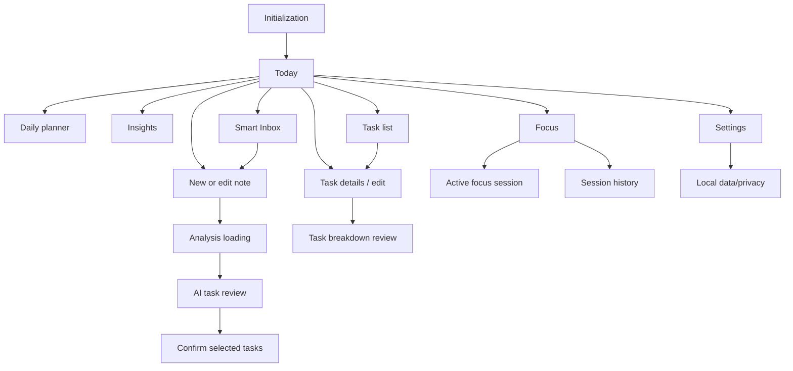

# Screen specifications

## Navigation map

Primary navigation is Today, Inbox, Tasks, Focus, Settings. Keep state per tab. Task details are reached from any task row and return to the originating destination. Editor/review/breakdown use nested destinations with explicit discard handling. Modal dismissal follows platform back/swipe behavior; unsaved text prompts Save draft / Discard / Keep editing. Android back first closes the active modal/nested route, then returns to the previous destination; iOS uses navigation back and sheet dismissal. Deep links are deferred from MVP; reserve stable task IDs and route parsing for future notification links.

## Shared screen rules

Every screen has a stable title, accessible focus order, safe-area-aware scrollable content, and clear recovery. Loading states are task-specific and never fabricate percent completion. Offline status is shown at the point a remote AI action is unavailable; local operations remain enabled. Long titles wrap, controls remain reachable, and large text may move metadata onto a second line.

## Screen inventory and specifications

### A. Initialization

Brief brand mark and app name while local settings/database initialize. Route promptly to Today. Recoverable initialization failure offers Retry and explains whether local data could be opened; do not trap the user behind an indefinite splash. Platform launch screen remains native and brief.

### B. Today dashboard

Header: localized date and concise greeting; no assumed name. Show a small planned-time summary (“2h 30m planned”) and one “Next up” task with completion control. Follow with today's ordered task rows, then a compact focus summary and unobtrusive Insights link. A persistent capture action opens note editor; quick task action opens a minimal task form. Do not show a calendar grid.

- New user/no tasks: explain capture and manual task creation; offer one example prompt clearly labeled as sample text, never a fake task.
- Active plan: next action, ordered items, planned duration; empty schedule slots are not implied.
- All complete: acknowledge completion and link to review/plan tomorrow without score or pressure.
- Overdue: separate overdue section with date and quick reschedule/edit; do not move deadlines silently.
- Offline: normal local dashboard with a quiet offline indicator; AI capture remains saveable and analysis action explains connection requirement.
- Loading: skeleton rows only while local store is first observed; recoverable store error with retry.

### C. Smart Inbox

Top search field and fast “Capture a thought” entry. Notes list shows first lines, updated date in the device timezone, and whether unprocessed, reviewed, or archived. Note actions: edit, analyze, archive/restore, and confirmed permanent delete. Filters: All, To review, Reviewed, Archived; search matches local title/body. Empty state invites writing; offline state permits all local note actions. Search/filter no-result state explains how to broaden results.

### D. Note editor and AI analysis

Single focused surface: title optional, multiline body, Save, Cancel, and “Suggest tasks” action. Keyboard submit saves; AI action is explicit. Show remaining/maximum input length and inline empty/too-long errors. Save local draft before remote call. Analysis loading states “Reading your note…” with Cancel; disable duplicate submission. Cancellation returns to editable source. On failure preserve note and edits, show cause where safe and Retry. If offline, save locally and offer analysis when connected. No invented progress.

### E. AI task review

Header states “Suggestions from this note” and count; explain that nothing is saved until confirmation. Each proposal has selection, title, optional description, priority, duration, date, subtasks, edit, and reject. Mark each field “Mentioned”, “Interpreted”, or “Not provided” when provenance matters. Dates with ambiguity remain unset and surface a clarification hint. User can add a task manually, accept selected, or select all after review. Confirmation sheet lists count and consequence; only confirm writes local tasks. Changes to suggestions stay in draft until confirmed.

- No tasks: retain note and offer edit/retry/manual task creation.
- Partially invalid/incomplete: show usable proposals, flag omitted fields, and let user edit; malformed task entries are skipped with a nontechnical explanation.
- Duplicate proposals: flag likely duplicates and allow keep/edit/remove; never silently merge.
- Request failure: return to note with retry; no task writes.
- Empty selection: disable confirm and explain selecting at least one.

### F. Task list

Search and filter chips (All, Open, Completed, Overdue), sort by plan order, deadline, priority, or creation. Compact rows show completion, title, priority, date and estimate when present. FAB or top action creates a task without AI. Empty and no-result states have distinct copy. Offline behavior is identical because data is local. Details open from the row; checkbox action updates immediately with undo.

### G. Task details/edit

Open task create/edit as a full-height secondary screen with a pinned app bar and animated forward/back navigation. Include title, description, status, priority, optional calendar-picked date-only deadline, estimate, ordered subtasks, and created/updated metadata. Save/Cancel; validation is inline. Complete/undo completion available. Archive is reversible; delete confirms or offers undo, with permanent removal only after confirmation. Empty subtasks show Add step. AI breakdown never mutates existing subtasks without explicit selection and confirmation.

### H. Task breakdown

Show parent task and current user-authored steps. AI-produced steps have “Suggested steps” label, editable titles, select/reject controls, loading/cancel/retry. Empty/error states retain parent and existing steps. Confirmation adds only selected steps and never replaces existing content. If offline, manual editing remains enabled while AI breakdown explains its network requirement.

### I. Daily planner

Localized selected day, ordered task list, planned-time total, and priority/deadline metadata. Reorder with accessible move up/down actions (drag is an enhancement, never sole method). Add/remove tasks from plan; removing from day does not delete the task. Describe order as a recommendation. Do not render time blocks or working hours until user-configured availability exists. Empty plan supports add from task list. Date navigation preserves state.

### J. Focus timer and history

Setup permits optional task selection and duration; untied session is first-class. Active view has large elapsed/remaining time, task name if any, and Start/Pause/Resume/Finish. Discard asks for confirmation and states whether elapsed time is saved (default: discard). Completion gives calm confirmation and persists a completed session. Timer display derives from persisted wall-clock timestamps and monotonic elapsed accumulation across pause segments; reconcile on foreground/process restoration. History lists date, duration, linked task and completion status. Offline works fully. If clock changes create an invalid interval, ask/reconcile from monotonic checkpoint when available and never show negative duration.

### K. Insights

Insights live inside Focus. The 7-day and 30-day selectors are rolling windows ending now. Show completed task count (only tasks with a recorded completion timestamp), focus time and average session length (saved running time from completed sessions only), completed session count, and a seven-bucket trend for completed sessions. Explain these calculations in the UI. Tasks already completed before schema v9 have no reliable timestamp and are excluded with an explanatory note. Do not show a composite productivity score or make causal claims.

### L. Settings/profile

Theme: System/Light/Dark with an immediate preview and locally persisted selection. Language selection opens a dialog with English, Persian, Spanish, French, and Arabic; Persian and Arabic switch the shared layout to RTL and date labels use the selected locale. Focus default offers 15, 25, 45, or 60 minutes and is reflected on the Focus screen. AI section identifies the current sample mode and states that no service is contacted; when a backend is configured it must explain that note text is sent only after an explicit request. Privacy section explains local storage and clear-data impact. Clear local data requires explicit confirmation and a final destructive action. Show app version and project links when real values are configured. No fake account or subscription UI.

## Interaction and feedback rules

- Complete toggles immediately, announce status, and show a branded toast with Undo.
- Deleting/archive behavior states whether reversible; clearing all data always confirms.
- Dialog/sheet dismissal preserves draft; destructive discard is explicit.
- Retry repeats only the failed AI operation using the preserved source and cannot create tasks by itself.
- Local edits propagate by observing the local store; every destination reflects the same task state.
- Keep the compact FocusAI top app bar pinned while destination content scrolls. Animate the task FAB away while scrolling down and back in while scrolling up.
- Touch targets are at least 48dp; labels, status and focus order remain available to assistive technology.
Focus also includes an explainable rhythm card with rolling 7-day and 30-day filters. It reports completed focus time, completed session count, average completed-session length, timestamped task completions, and a seven-bucket completed-session trend. The window ends now and spans exactly 7×24 or 30×24 hours; trend buckets split that window evenly. Only completed sessions count toward focus metrics. Tasks completed before schema v9 do not have reliable completion timestamps, so they are excluded from the task count and the UI identifies this limit.
